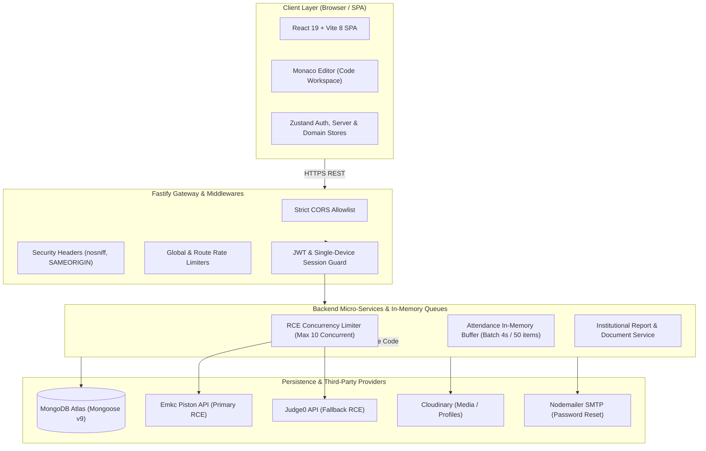

# Architecture Audit & Threat Model

**Platform:** Code Circle ⭕  
**Scope:** Full-Stack Architecture, Data Flow, Boundary Analysis, and Threat Model  
**Audit Date:** November 2026  
**Auditor:** Senior Full-Stack Architect & Senior Application Security Engineer  

---

## 1. Stack Detection & Architectural Overview

Code Circle is an asynchronous, high-throughput campus learning and competitive assessment platform. The architecture comprises a decoupled Single Page Application (SPA) frontend, a Fastify v5 TypeScript backend, a MongoDB Atlas persistence layer, and external cloud services for isolated remote code execution and media hosting.

### Technology Summary:
- **Frontend:** React 19.2.4, Vite 8.0.1, TypeScript 7.0.2, TailwindCSS v4.2.2, HeroUI 3.2.7, Radix UI primitives, Zustand 5.0.12, TanStack React Query 5.102.8, Monaco Editor 4.7.0.
- **Backend:** Node.js (CommonJS + TypeScript 7.0.2 via `tsx` and `tsc`), Fastify 5.8.2, `@fastify/cors` 11.2.0, `@fastify/rate-limit` 11.2.2, `@fastify/multipart` 9.4.0, `@fastify/static` 9.3.0.
- **Database & ODM:** MongoDB Atlas M0 cluster via Mongoose 9.3.1.
- **Authentication:** Signed JSON Web Tokens (symmetric HMAC-SHA256) with single-device active session invalidation (`activeSessionId` tracking).
- **External Integrations:**
  - Remote Code Execution (RCE): Emkc Piston API v2 with automatic failover to Judge0 API.
  - Media & Template Storage: Cloudinary v2 SDK.
  - Email Communications: Nodemailer with SMTP credentials.
  - Identity Verification: Firebase Admin SDK for Google OAuth tokens.

---

## 2. Threat Model & Trust Boundaries

### 2.1 User Roles & Privilege Matrix
The platform defines a 5-tier role hierarchy:
1. **SuperAdmin:** Universal clearance. Can configure system settings, promote administrators, trigger forced database synchronizations, and access all tenant data.
2. **Admin:** Full administrative operations over student rosters, bulk imports, assessments, attendance sessions, and password resets. Cannot modify SuperAdmin records.
3. **Faculty / Committee:** Can review event documentation, issue attendance sessions, evaluate coding submissions, and generate institutional event reports.
4. **Member / Student:** Standard authenticated tier. Can view curriculum, attempt quizzes, execute sandbox code, submit contest solutions, and mark event attendance.
5. **Anonymous / Public:** Unauthenticated browser sessions. Permitted only to view landing info, verify certificates via public hash/ID, and submit login/registration requests.

### 2.2 Sensitive Assets & Data Inventory
- **User Credentials & Secrets:** Bcrypt-hashed passwords (10 salt rounds), active session UUIDs, JWT tokens, password reset OTPs/tokens.
- **Academic & Integrity Data:** Unreleased contest test cases, private MCQ answers, anti-cheat tab-switch counts, proctoring violation logs.
- **Personal Identifiable Information (PII):** Student roll numbers, institutional email addresses, personal phone numbers, dates of birth, residential types (Hosteller/Day Scholar).
- **Institutional Governance Records:** Formal event attendance registers, signed certificate templates, committee documentation and meeting reports.

### 2.3 Trust Boundaries
1. **Boundary A (Public Internet ↔ Fastify Gateway):** Untrusted input boundary. Fastify applies schema validation, CORS allowlisting, rate limiting, and parameter parsing.
2. **Boundary B (Fastify Gateway ↔ MongoDB Atlas):** Trusted application-to-database boundary over TLS. Mongoose enforces strict schemas and compound unique indexes.
3. **Boundary C (Fastify Backend ↔ External RCE Providers):** Untrusted code execution boundary. Fastify never executes user submissions on the application host; all source code is dispatched over HTTPS to sandboxed containers with size limits (64KB code, 32KB stdin) and execution timeouts (10s).
4. **Boundary D (Fastify Backend ↔ Cloudinary / SMTP):** Outbound provider boundary. Enforces payload validation before streaming files or dispatching emails.

### 2.4 Attack Paths & Threat Vectors
- **Vector 1: Attendance Spoofing & BOLA:** An attacker discovers an active event OTP in a lecture hall and forges attendance requests for colleagues. *(Remediated via SEC-01)*.
- **Vector 2: Cross-Origin Session Hijacking (CORS):** An attacker hosts a phishing site that makes cross-origin fetch requests to the Fastify API with credentials. *(Remediated via SEC-04)*.
- **Vector 3: Administrative Token Forgery:** An attacker exploits missing `JWT_SECRET` in misconfigured deployments to sign SuperAdmin JWTs using the public fallback key. *(Remediated via SEC-03)*.
- **Vector 4: Malicious File Upload & MIME Confusion:** An attacker uploads a script or HTML payload to Cloudinary via profile endpoints. *(Remediated via SEC-05)*.
- **Vector 5: DoS via Auth & RCE Flooding:** An attacker sends bursts of compilation requests or brute-force login attempts. *(Mitigated via SEC-06 and RCE Concurrency Limiter)*.

---

## 3. Structural & Architectural Evaluation

### 3.1 Frontend Architecture
- **State Management:** Clean separation between local UI state (React hooks) and shared global stores (Zustand). Zustand stores (`useAuthStore`, `useServerStore`, `useDomainStore`, `useEventArenaStore`) avoid unnecessary context re-renders.
- **Resiliency & Offline Defense:**
  - Auto-save mechanism (`useAutoSave.ts`) persists student answers to `localStorage` every 30 seconds during exams, preventing data loss on browser crash or network interruption.
  - Multi-node backend health probe (`useServerStore.ts`) races candidate server instances to ensure connectivity.
- **Weaknesses Identified & Remedied:**
  - Monolithic bundle size initially generated a 642 kB `index` chunk. Resolved with Rollup `manualChunks`.
  - Cold-start development delay in `useServerStore` was waiting 6.5s for Render free-tier timeouts. Resolved by prioritizing local nodes and reducing probe timeouts to 3.5s.

### 3.2 Backend Architecture & Concurrency Architecture
- **In-Memory Attendance Buffer (`attendanceBuffer.ts`):**
  - High-concurrency OTP verification is handled entirely in RAM using JavaScript `Map` and `Set` structures ($O(1)$ operations).
  - Submissions are queued in `writeQueue` and flushed in bulk (`bulkWrite` with `upsert: true`) every 4000ms or when the queue hits 50 items. This protects MongoDB Atlas M0 (50 connection limit) from connection pool starvation during simultaneous campus check-ins.
- **RCE Concurrency Limiter (`concurrencyLimiter.ts`):**
  - Enforces a maximum concurrency ceiling (default: 10 concurrent executions) on outbound Piston/Judge0 calls.
  - Queued requests exceeding capacity wait in a FIFO queue or fail gracefully with a timeout error rather than overwhelming the server process.

### 3.3 Architectural Technical Debt & Dead Code
- **Hybrid JS/TS Codebase:**
  - Legacy `.js` controllers and routes (`uploadController.js`, `analyticsRoutes.js`, `enrollmentRoutes.js`, `quizRoutes.js`) remain in `backend/src/` alongside migrated `.ts` files.
  - Build script currently relies on `copyJsToDist.js` to copy non-compiled JS files to `dist/`.
  - *Recommendation:* Complete migration of remaining 6 JavaScript files to TypeScript to unify the type safety layer.
- **Dual Attendance Routes:**
  - Attendance logic exists both in `routes/attendanceRoutes.ts` (session creation, manual marks) and `routes/attendance.ts` (buffered high-throughput OTP submissions).
  - *Recommendation:* Consolidate attendance endpoints under a unified `attendanceRoutes.ts` router in a future release.
